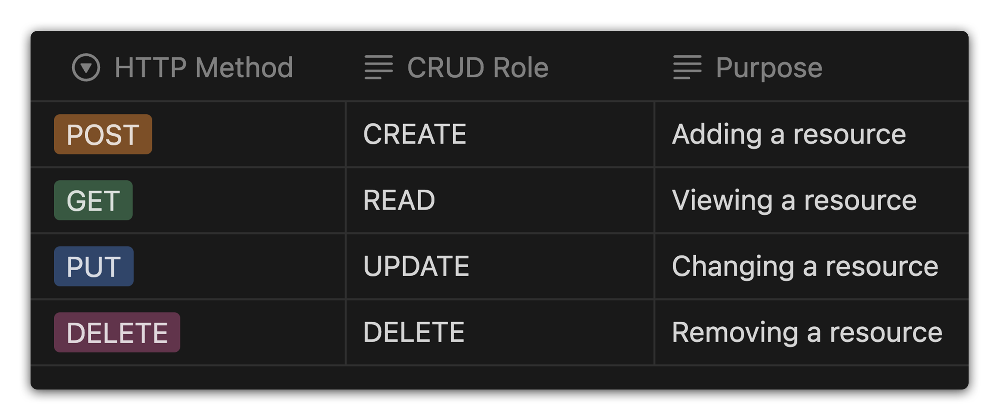

# 

**Learning objective:** By the end of this lesson, students will understand what REST architecture is, and how it applies to routing. 

## What is REST

REST, short for REpresentational State Transfer, is a guiding architectural style for web applications, focusing on the client-server relationship. It's a set of principles that simplifies how web resources are defined and addressed.

### Breaking Down REST

#### Resources and Representations

At the heart of REST is the concept of a *resource*. In the the context of a web environment, everything - from database data, HTML files, images, to videos - is considered a resource. You've encountered *URLs* which are essentially the addresses where these resources are located.

The "Representational" aspect of REST is about how these resources are presented to a client (like a browser). When a client requests a resource, the server responds with a *representation* of it. This representation is not the resource itself but a portrayal of its *current state*, often in formats like JSON or XML.

#### State Transfer

The "State Transfer" part of REST revolves around how the client and server communicate or exchange the state of resources. For instance, if you're interacting with a blog, retrieving all posts involves receiving their current state from the server. Conversely, adding a new post means sending its details to the server, which updates the blog's data.

#### REST's Universality

What makes REST versatile is its independence from any specific programming language or framework. It's not about the resources themselves but how their states are represented and transferred in a web environment.

Systems adhering to REST principles are known as REST-compliant or *RESTful*. This architectural style underpins much of the internet's design, offering a standardized approach to structuring and handling web resources.

## RESTful routing

As you might have guessed, "RESTful routing" is applying REST architecture to routing.

In REST, there is a clear separation between the client and server. The client sends requests to retrieve or modify resources, and the server sends responses to those requests. 

In order to facilitate this, RESTful routes map HTTP verbs (get, post, put, and delete) to [CRUD](https://developer.mozilla.org/en-US/docs/Glossary/CRUD) counterparts: 

| HTTP Method | CRUD role | Purpose |
| -- | -- | -- |
| POST | CREATE | Adding a resource |
| GET | READ | Viewing a resource |
| PUT | UPDATE | Changing a resource |
| DELETE | DELETE | Removing a resource |

## Why use RESTful routing conventions?

REST is a convention that makes your application predictable - it's a well understood architecture that other developers can easily adapt to and interpret. REST is also designed around server-client separation, which helps with both scalability and flexibility as the client and server can be changed and expanded separately. 

As mentioned above, REST is also language agnostic - even as languages or frameworks change, the communication between client and server stays the same! 