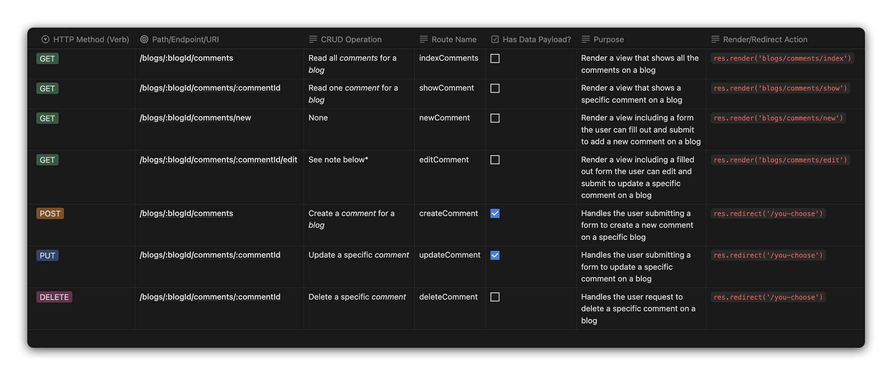

# 

## Routing for Embedded Resources (One:Many Relationships)

Below is a table demonstrating typical RESTful routing that you may experience when working with Embedded Resources.



> *NOTE: The `edit` route may optionally read data for a specific blog to pre-fill data in the form that will ultimately be rendered to the user.

> If a route is marked as having a data payload, it means there is data that will be sent from the client to the server with the request.

**Here is a more accessible code version of the same chart:**

```text
| HTTP Method (Verb) | Path/Endpoint/URI                       | CRUD Operation                   | Route Name    | Has Data Payload? | Purpose                                                                                                          | Render/Redirect Action               |
| ------------------ | --------------------------------------- | -------------------------------- | ------------- | ----------------- | ---------------------------------------------------------------------------------------------------------------- | ------------------------------------ |
| GET                | /blogs/:blogId/comments                 | Read all _comments_ for a _blog_ | indexComments | No                | Render a view that shows all the comments on a blog                                                              | `res.render('blogs/comments/index')` |
| GET                | /blogs/:blogId/comments/:commentId      | Read one _comment_ for a _blog_  | showComment   | No                | Render a view that shows a specific comment on a blog                                                            | `res.render('blogs/comments/show')`  |
| GET                | /blogs/:blogId/comments/new             | None                             | newComment    | No                | Render a view including a form the user can fill out and submit to add a new comment on a blog                   | `res.render('blogs/comments/new')`   |
| GET                | /blogs/:blogId/comments/:commentId/edit | See note below*                  | editComment   | No                | Render a view including a filled out form the user can edit and submit to update a specific comment on a blog    | `res.render('blogs/comments/edit')`  |
| POST               | /blogs/:blogId/comments                 | Create a _comment_ for a _blog_  | createComment | Yes               | Handles the user submitting a form to create a new comment on a specific blog                                    | `res.redirect('/you-choose')`        |
| PUT                | /blogs/:blogId/comments/:commentId      | Update specified _comment_       | updateComment | Yes               | Handles the user submitting a form to update a specific comment on a blog                                        | `res.redirect('/you-choose')`        |
| DELETE             | /blogs/:blogId/comments/:commentId      | Delete specified _comment_       | deleteComment | No                | Handles the user request to delete a specific comment on a blog                                                  | `res.redirect('/you-choose')`        |

*NOTE: The `edit` route may optionally read data for a specific blog to pre-fill data in the form that will ultimately be rendered to the user.
```